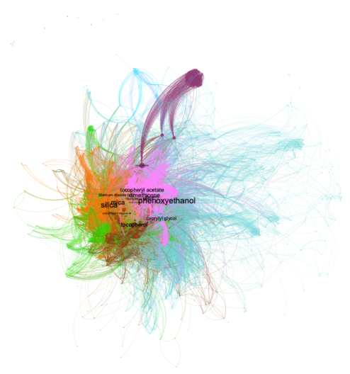
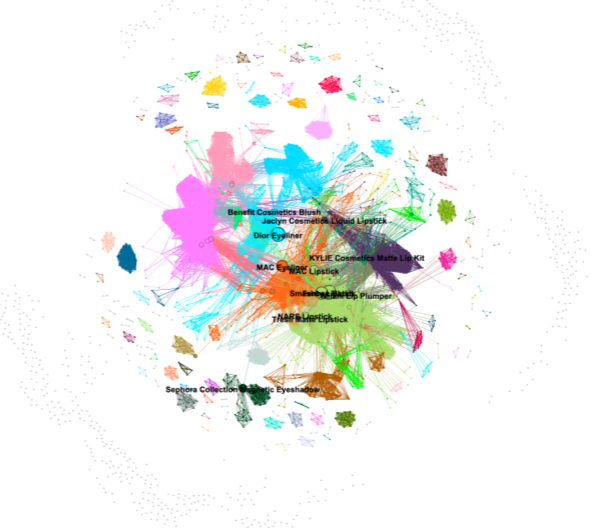

# Cosmetic Ingredient Network Analysis

**Exploring cosmetic formulations through Python, network science, and Gephi**

**Author:** Nadezhda Dominguez Salinas  
**Institution:** Macalester College  
**Project:** Network Science Capstone Spring 2026

## Overview

How similar are cosmetic products across different brands, and which ingredients play the most important roles in their formulations?

For this project, I applied network science to investigate ingredient relationships and formulation similarities across cosmetic products. Using an e-commerce dataset containing over 110,000 products, I focused on face, lip, and eye cosmetics and constructed two weighted networks:

1. **Ingredient Co-Occurrence Network:** Connects ingredients that appear together in the same product, with edge weights representing how frequently each ingredient pair co-occurs.
2. **Product-Product Network:** Connects cosmetic products based on shared ingredients, with edge weights representing the number of ingredients they have in common.

I used **Python and Google Colab** for data preprocessing and network construction, followed by **Gephi** for network visualization, centrality analysis, and community detection.

My goal was to understand which ingredients dominate cosmetic formulations, how products cluster across categories and brands, and what network structure can reveal about similarities that may not be obvious from product marketing.

## Technical Skills Demonstrated

| Skill | Application |
|---|---|
| Python Programming | Processed ingredient lists, generated ingredient combinations, and constructed weighted graph data |
| Data Cleaning | Standardized ingredient strings and removed duplicate ingredient entries |
| Graph Construction | Created two undirected, weighted networks from product and ingredient relationships |
| Network Analysis | Applied weighted degree, betweenness centrality, eigenvector centrality, and PageRank |
| Community Detection | Used modularity-based clustering to identify related ingredients and products |
| Data Visualization | Used Gephi to visualize large networks and investigate community structure |
| Problem-Solving | Experimented with backbone extraction and filtering thresholds to reduce graph density |
| Technical Communication | Documented methods, results, and limitations in a research report and presentation |

## Dataset

The dataset was obtained from Kaggle:

[E-commerce Cosmetic Products Dataset](https://www.kaggle.com/datasets/devi5723/e-commerce-cosmetics-dataset)

The original dataset contained over 110,000 cosmetic products collected from online retailers, including Sephora, Ulta, Amazon, and Flipkart.

Each product included information such as:

- Product name and brand
- Category and subcategory
- Price and rating
- Ingredient list

For this analysis, I focused on makeup products in the **eyes, lips, and face** categories and excluded products without ingredient information.

## Methodology

### 1. Data Preprocessing

Before constructing the networks, I cleaned and standardized the ingredient lists using Python.

The preprocessing included:

- Converting ingredient names to lowercase
- Removing numerical concentrations, punctuation, and extra whitespace
- Splitting ingredient lists into individual ingredients
- Removing duplicate ingredients within each product

This step was important because inconsistent ingredient formatting could create duplicate nodes and distort the network analysis.

### 2. Ingredient Co-Occurrence Network

The first network represents relationships between ingredients that appear together in cosmetic products.

**Network construction:**

- Each node represents a cosmetic ingredient.
- An undirected edge connects two ingredients when they appear in the same product.
- Edge weights represent the number of products containing that ingredient pair.

I used Python to generate unique ingredient combinations and count their co-occurrences across products.

The initial network was extremely dense, making it difficult to identify meaningful patterns.

To address this, I applied backbone extraction and filtered nodes using a minimum weighted degree of 95.

After filtering, I used Gephi to analyze centrality measures and identify communities of frequently associated ingredients.

### 3. Product-Product Network

The second network examines similarities between cosmetic products based on their ingredient lists.

**Network construction:**

- Each node represents a cosmetic product.
- Two products are connected when they share at least five ingredients.
- Edge weights represent the number of shared ingredients.

I experimented with different filtering thresholds to reduce network density and improve interpretability.

For the final visualization, I retained connections between products sharing at least 13 ingredients.

**Final filtered network:**

| Metric | Value |
|---|---|
| Nodes | 2,787 |
| Edges | 32,080 |
| Detected Communities | 977 |
| Minimum Shared Ingredients | 13 |

This network allowed me to examine formulation similarities across different cosmetic categories, brands, and product lines.

## Network Visualizations

### Ingredient Co-Occurrence Network

*Ingredient co-occurrence network after backbone extraction and weighted-degree filtering. Colors represent communities identified in Gephi.*

### Product-Product Network

*Product similarity network showing relationships between cosmetics sharing at least 13 ingredients. Colors represent detected communities.*

## Key Findings

### 1. Common Ingredients Dominate Cosmetic Formulations

Weighted-degree analysis identified several highly connected ingredients.

| Ingredient | Weighted Degree |
|---|---:|
| Silica | 30,283 |
| Mica | 29,758 |
| Phenoxyethanol | 28,449 |
| Titanium Dioxide (CI) | 25,819 |
| Dimethicone | 25,400 |

These ingredients are commonly used for pigmentation, texture, preservation, and other formulation purposes.

Phenoxyethanol also had the highest betweenness centrality in the ingredient network, indicating its role in connecting different ingredient communities.

### 2. Ingredient Communities Reflect Formulation Functions

Gephi identified **26 communities** in the filtered ingredient network.

Several communities contained ingredients with similar purposes, including:

- Pigments and fillers
- Preservatives and silicone-based ingredients
- Emulsifiers and stabilizers
- Waxes, butters, and fragrances

One smaller community contained ingredients associated with potential safety concerns, including certain parabens and heavy metals.

This was an exploratory finding about ingredient co-occurrence, not a direct assessment of product toxicity or safety.

### 3. Products Share Formulations Across Brands and Categories

The product-product network revealed similarities between products that may appear different based on their branding.

Some of the strongest communities included:

- Lipsticks and lip glosses sharing common ingredient combinations
- Eye products such as eyeliners, mascaras, and eyeshadows
- Concealers and other face products with similar formulations

Smaller communities also showed brand-specific clustering.

For example, one cluster consisted of Huda Beauty concealers with closely related formulations.

### 4. Clinique Products Were Highly Connected

PageRank analysis identified several Clinique products among the most highly ranked nodes in the product network.

This suggested that their ingredient combinations overlapped with many other cosmetic products in the dataset.

The finding illustrates how network analysis can reveal similarities between formulations across brands and product categories.

## Challenges and Problem-Solving

### Data Consistency

Some ingredient names differed only in numerical concentrations or formatting.

I addressed this by standardizing ingredient lists before constructing the networks, reducing duplicate entries and improving consistency.

### Constructing Weighted Networks

Generating unique ingredient combinations and correctly counting repeated co-occurrences required careful implementation.

I worked through the logic for assigning edge weights and exporting node and edge lists for both networks.

### Managing Dense Networks

The ingredient network initially contained too many connections for meaningful visualization.

I experimented with backbone extraction and weighted-degree thresholds to reduce density while retaining the core network structure.

For the product network, I tested different minimum shared-ingredient thresholds before selecting 13 for the final visualization.

### Interpreting Communities

Not every detected community corresponded neatly to a single cosmetic category or ingredient function.

I examined the ingredients, product categories, and brands within major communities to interpret the patterns identified through network analysis.

## Project Materials

The following materials document the implementation, analysis, and results:

- [Python Analysis Notebook](analysis.ipynb) — Data preprocessing and construction of the ingredient and product networks.
- [Research Report](research-report.pdf) — Full research paper describing the methodology, centrality analysis, community detection, findings, and limitations.
- [Project Presentation](project-presentation.pdf) — Slides summarizing the research questions, network visualizations, and results.

## Limitations

The dataset relied on ingredient information from online retailers, which may not reflect the latest product formulations.

Additionally:

- Ingredient concentrations were not available, so the analysis measured co-occurrence rather than chemical quantities.
- Network filtering thresholds influenced the resulting graph structure and detected communities.
- Product pricing, customer reviews, and ratings were not incorporated into the network analysis.
- Ingredient co-occurrence alone cannot establish whether a cosmetic product is safe or harmful.

## Future Work

Potential extensions of this project include:

- Incorporating ingredient safety datasets to investigate potential risks more systematically
- Constructing a bipartite network connecting products directly to their ingredients
- Comparing formulations across different time periods
- Exploring relationships between formulation similarity, product prices, and customer ratings
- Extending the analysis to other beauty product categories

## Project Background

This project was completed as an individual Network Science Capstone at Macalester College in the Spring of 2026.

It gave me experience applying Python programming, graph theory, network analysis, and data visualization to a real-world dataset.

The most valuable part of the project was learning how to turn raw ingredient information into meaningful networks, work through challenges in graph construction and filtering, and communicate findings through research and visualization.
